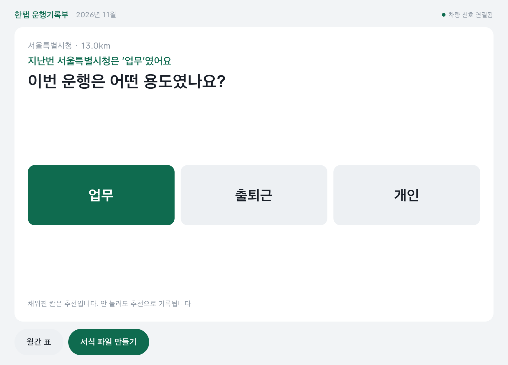
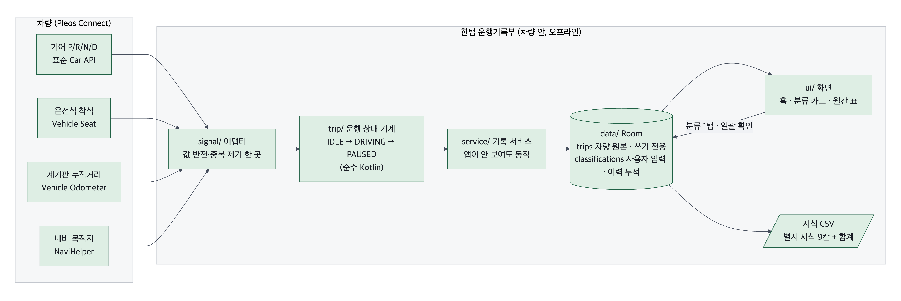

# 한탭 운행기록부

정차한 자리에서 버튼 한 번으로 업무용 승용차 운행기록부가 끝나는 차량용 앱 (Pleos Connect, Android Automotive).

- 기어를 D에 넣으면 기록이 시작되고, 거리는 계기판 누적거리로 씁니다.
- P에 넣으면 '업무 / 출퇴근 / 개인' 분류 카드가 뜹니다. 전에 간 목적지면 분류를 미리 골라 둡니다.
- 월간 표에서 업무사용비율을 보고, 국세청 별지 서식 칸 순서의 파일(CSV, 엑셀에서 열림)을 만듭니다.



## APK

- 위치: 이 저장소의 **Releases → `v0.1`** 에 `OdoWorks_HantapLogbook_release.apk`로 첨부 (용량 약 20MB라 저장소에는 넣지 않음)
- release 빌드, 서명됨. 패키지 `io.odoworks.logbook`, 버전 0.1 (versionCode 1)

## 테스트 환경

| 항목 | 값 |
|---|---|
| 에뮬레이터 | Pleos Connect Emulator v2.1 (system image `android-34;pleos_car_emulator;arm64-v8a`) |
| 차량 신호 조작 | 에뮬레이터 내장 Virtual Console (`http://127.0.0.1:8088/`) |
| 앱 요구 사항 | Android API 28 이상 (minSdk 28, targetSdk 35) |
| 빌드 | Kotlin, Gradle 8.10.2(wrapper 포함), JDK 17~21 |
| 사용 SDK | Pleos Vehicle SDK 2.3.2 (Odometer, Seat), NaviHelper 3.0.5, Android Car API(기어) |

## 실행 방법

### 1. APK 설치

```sh
emulator -avd <Pleos 에뮬레이터 AVD 이름> -timezone Asia/Seoul
adb install -r OdoWorks_HantapLogbook_release.apk   # Releases에서 받은 파일
adb shell am start -n io.odoworks.logbook/.ui.MainActivity
```

- 시간대를 주지 않으면 에뮬레이터가 미국 시간으로 떠서 기록 시각이 한국과 어긋납니다.
- 앱은 처음 실행할 때 기록 서비스를 시작합니다. 이후에는 화면을 닫아도 기록됩니다.

### 2. 차량 신호로 시나리오 재현 (Virtual Console)

```sh
adb forward tcp:8088 tcp:8088
# 브라우저에서 http://127.0.0.1:8088/ 을 열어 둔다 (탭이 열려 있어야 조작이 반영됨)
```

1. Seat Occupancy에서 운전석을 Occupied로 둡니다.
2. Gear Selection을 Drive로 바꿉니다. 앱 홈에 "주행 중"과 거리가 나옵니다.
3. 누적거리(Odometer)를 몇 km 올립니다. 앱의 주행 거리가 따라 올라갑니다.
4. Gear를 Park로 바꿉니다. 분류 카드가 뜹니다. '업무'를 누릅니다.
5. 같은 목적지로 다시 주행 후 Park로 바꾸면, 카드에 추천("지난번 ○○은 '업무'였어요")이 채워져 나옵니다.
6. Park 상태가 10분(release 기준) 이어지면 운행이 끝나고 월간 표에 한 줄이 생깁니다.
7. 홈의 "서식 파일 만들기"로 CSV를 만듭니다.

- 목적지 추천은 내비 목적지가 있어야 동작합니다. 에뮬레이터 내비에서 목적지를 설정한 뒤 주행하세요.
- 에뮬레이터에서는 운전석 값이 Virtual Console과 반대로 들어와, 앱이 이를 뒤집어 해석합니다(실차 확인 예정).

### 3. 소스에서 빌드

```sh
cd app
./gradlew test assembleDebug      # 단위 테스트 + debug APK (debug는 운행 종료 대기 1분)
./gradlew assembleRelease         # release APK (서명 키가 없으면 서명 없이 만들어짐)
```

결과: `app/logbook/build/outputs/apk/`

## 구조



- `signal/` 차량 신호 받기(기어·운전석·누적거리·내비 목적지)
- `trip/` 운행 상태 기계(대기 → 주행 → 정차), 순수 Kotlin
- `data/` 로컬 DB(Room). 차량 원본과 사용자 분류를 따로 저장
- `service/` 기록 서비스(앱이 안 보여도 동작)
- `ui/` 홈, 분류 카드, 월간 표(Compose)
